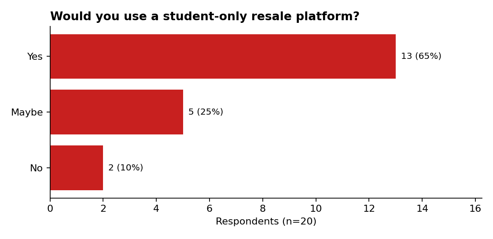
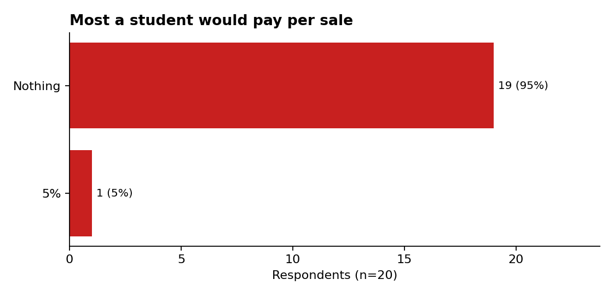
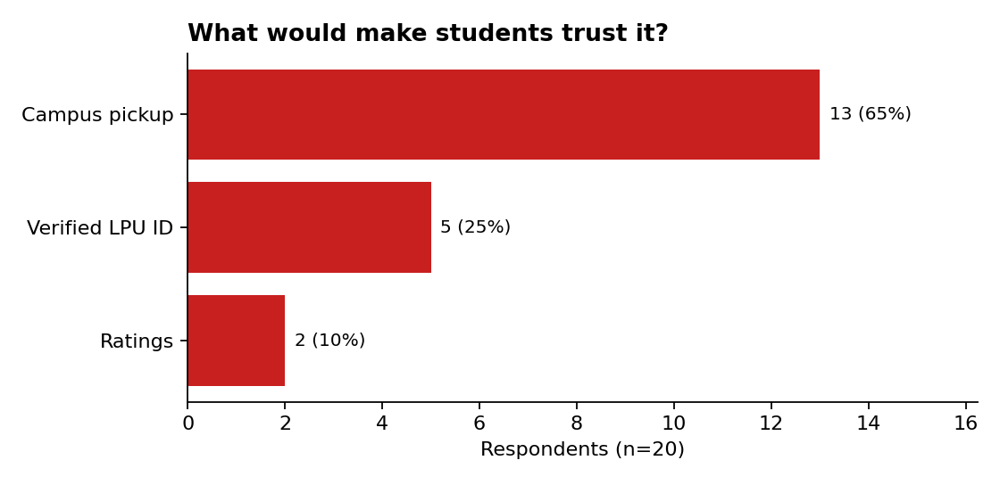

# CampusResell Survey Analysis

Pilot demand test for a student-only resale marketplace at Lovely Professional University (LPU).
Individual business project by Rishav Singh (BBA, 1st year).

## Idea
Students on a large residential campus repeatedly buy and discard books, cycles, appliances and
electronics, with no trusted way to trade them. CampusResell would be a student-only marketplace.

## Method
- 10-question anonymous Google Form shared with LPU students (19 Oct 2026)
- **20 responses** (11 day scholars, 9 hostel students; years 1 to 4+)
- Analysed in Python (pandas, matplotlib): see `analysis.py` and `survey_responses.csv`

## Findings
| Question | Result |
|---|---|
| Bought second-hand items on campus in last year | 95% |
| Sold or discarded items at end of semester | 95% |
| How they find buyers/sellers today | WhatsApp groups 65%, friends 30%, throw away 5% |
| Would use a student-only resale platform | Yes 65%, Maybe 25%, No 10% |
| What would build trust | Campus pickup 65%, verified LPU ID 25%, ratings 10% |
| Most they would pay per sale | **Nothing 95%**, 5% fee 5% |

## What this means
1. **Demand signal is positive:** 90% said yes or maybe, and trading today runs through informal
   WhatsApp groups and friends, which suggests an unsolved problem.
2. **A per-sale commission is not supported:** 19 of 20 would pay nothing. Revenue would need to come
   from elsewhere (for example featured listings, local business partnerships or sponsored
   listings), which is the next thing to test.
3. **Trust design:** campus pickup is the top trust factor, so a meetup-point model should be part of the product.

## Limitations (honest notes)
- Small convenience sample (n=20), collected within about 10 minutes, so it likely over-represents the
  author's own network. Treat this as a pilot, not proof of market size.
- Almost everyone had bought and sold items, so respondents may already care about the topic (self-selection).
- The "fair price difficulty" question (Q7) was set up as multiple choice with broken labels and is
  excluded from the analysis.
- "What did you buy" allowed one visible answer; 'Other' entries (headphones, smart watch) were not analysed further.

## Next steps
Collect more responses from a wider spread of students, fix Q7 as a 1-5 scale, and test alternative revenue models.
